  

 

## 👋 About me

**Frontend-focused full-stack developer** from Colombia 🇨🇴, now based in Bilbao, Spain 🇪🇸. I turn creative visions into modern, elegant interfaces with **React + TypeScript**.

- 🤖 Master's in Computing and Intelligent Systems (MUCSI) at **University of Deusto** — Sep 2026 – present
- 🎓 Electronics & Telecommunications Engineering at **University of Cauca** — Mar 2024

 

## 🛠️ Tech stack

  

 

## 🚀 Featured projects

<table>
  <tr>
    <td width="50%" valign="top">
      
      <h3>🥐 Buch · Bakery & Café</h3>
      
Brand identity and landing page for an artisan bakery concept — logo, palette and a full visual system in warm earthy tones.

      
<code>React</code> <code>TypeScript</code> <code>Tailwind v4</code>

      
<a href="https://buchbakery.vercel.app"><b>Live demo →</b></a>

    </td>
    <td width="50%" valign="top">
      
      <h3>🍸 Brysa · Cóctel & Tapas</h3>
      
Brand identity and landing page for a premium cocktail bar in Cali — dark, elegant, with a rotating artisan cocktail menu.

      
<code>React</code> <code>TypeScript</code> <code>Tailwind v4</code>

      
<a href="https://brysa.vercel.app"><b>Live demo →</b></a>

    </td>
  </tr>
  <tr>
    <td width="50%" valign="top">
      
      <h3>🌎 Bio Sphere</h3>
      
Real-time environmental dashboard to monitor air quality, temperature, humidity and more.

      
<code>React</code> <code>TypeScript</code> <code>Tailwind</code> <code>HeroUI</code>

      
<a href="https://bio-sphere-frontend.vercel.app/"><b>Live demo →</b></a> · <a href="https://github.com/JorgeAVargasC/bio-sphere-frontend">Code</a>

    </td>
    <td width="50%" valign="top">
      
      <h3>📲 QR Code Generator</h3>
      
Fully customizable QR codes — tweak colors, shapes and styles to match any brand.

      
<code>React</code> <code>TypeScript</code> <code>Tailwind v4</code>

      
<a href="https://javc-qr-code-generator.vercel.app"><b>Live demo →</b></a> · <a href="https://github.com/JorgeAVargasC/qr-code-generator">Code</a>

    </td>
  </tr>
</table>

  <a href="https://jorgeavargasc.github.io/"><b>See everything on my portfolio →</b></a>

 

## 💬 What teammates say

> *"The dictionary defines superlative as 'of the highest kind, quality, or order; surpassing all else or others; supreme.' I define it as Jorge Vargas. As a Frontend Developer Lead, as an Engineer, as a friend."*
>
> — **[Daniel Gómez](https://linkedin.com/in/dgomez216)**, Product Developer · IT Project Manager · Scrum Master

> *"One of the most resilient and talented frontend developers I've encountered. From tackling complex UI challenges to optimizing user experiences, he brings not just technical expertise but also a problem-solving mindset that makes him a total rock star."*
>
> — **[Valentina Solano](https://www.linkedin.com/in/valentina-solano)**, Services Director

  <a href="https://www.linkedin.com/in/jorgeavargasc/details/recommendations/?detailScreenTabIndex=0">Read all recommendations on LinkedIn →</a>

 

## 📊 GitHub stats

 

**Let's build something great together** · [javargas1209@gmail.com](mailto:javargas1209@gmail.com)

